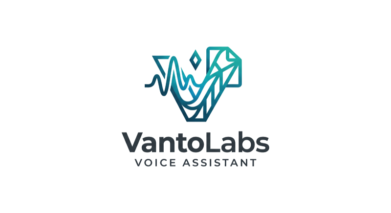

  

  ### Mówisz. Tekst ląduje tam, gdzie ma być.

  Asystent głosowy dla macOS i Windows: jeden skrót klawiszowy zamienia mowę w tekst
  w dowolnej aplikacji, a notatki głosowe i podsumowania spotkań trafiają do Twojego
  Obsidiana — jako zwykłe pliki Markdown. Twój klucz API, Twoje dane.

  *A voice assistant for macOS & Windows: one keyboard shortcut turns speech into text
  in any app; voice notes and meeting summaries land in your own Obsidian vault.
  Your API key, your data.*

  **🔧 Beta w budowie / Beta in progress**

  [vantolabs.pl](https://vantolabs.pl) · [English](https://vantolabs.pl/en)

